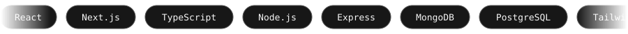

<div align="center">


<br/>

<a href="https://git.io/typing-svg">
  
</a>

<br/><br/>


&nbsp;

&nbsp;


</div>

---

<div align="center">



</div>

---

```
╔══════════════════════════════════════════════════════╗
║                    // ABOUT ME                       ║
╚══════════════════════════════════════════════════════╝
```

- ▶ Builds  **[Nodus](https://songdo.Nodus.mn)** — clinic management SaaS used by hospitals across Mongolia
- ▶ Builds **Govi AI** — multi-tenant Facebook Messenger AI chatbot powered by Groq, sold to Mongolian businesses
- ▶ Bilingual product builder — **Mongolian 🇲🇳 + English 🇬🇧**

---

```
╔══════════════════════════════════════════════════════╗
║                  // PROJECTS SHIPPED                 ║
╚══════════════════════════════════════════════════════╝
```

<div align="center">


</div>

---

```
╔══════════════════════════════════════════════════════╗
║                   // TECH STACK                      ║
╚══════════════════════════════════════════════════════╝
```

<div align="center">



**[ FRONTEND ]**

[](https://skillicons.dev)

**[ BACKEND & DATABASE ]**

[](https://skillicons.dev)

**[ TOOLS ]**

[](https://skillicons.dev)

</div>

---

```
╔══════════════════════════════════════════════════════╗
║                  // GITHUB STATS                     ║
╚══════════════════════════════════════════════════════╝
```

<div align="center">


&nbsp;


<br/>


</div>

---

```
╔══════════════════════════════════════════════════════╗
║              // CONTRIBUTION ACTIVITY                ║
╚══════════════════════════════════════════════════════╝
```

<div align="center">

[](https://github.com/ashutosh00710/github-readme-activity-graph)

</div>

---

```
╔══════════════════════════════════════════════════════╗
║             // CONTRIBUTION SNAKE                    ║
╚══════════════════════════════════════════════════════╝
```

<div align="center">


</div>

---

```
╔══════════════════════════════════════════════════════╗
║                   // TROPHIES                        ║
╚══════════════════════════════════════════════════════╝
```

<div align="center">

[](https://github.com/ryo-ma/github-profile-trophy)

</div>

---

```
╔══════════════════════════════════════════════════════╗
║                    // CONNECT                        ║
╚══════════════════════════════════════════════════════╝
```
<div align="center">

[](mailto:bilguun313131@gmail.com)
&nbsp;
[](https://songdo.Nodus.mn)
&nbsp;
[](https://anmon21.github.io/Anmon21/)
&nbsp;
[](https://www.instagram.com/anmon578/)

</div>

---

<div align="center">


</div>
